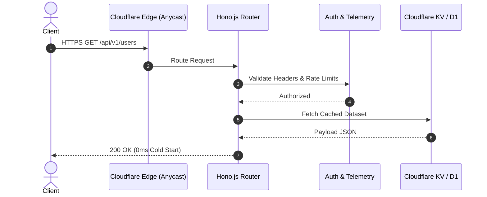

# ⚡ hono-edge-starter

[](https://github.com/MobileConduit/hono-edge-starter/releases/tag/v1.0.0)
[](LICENSE)
[](https://hono.dev)
[](https://workers.cloudflare.com)
[](https://github.com/MobileConduit/hono-edge-starter/actions)

Blazing fast edge REST API boilerplate architected with **Hono.js** and designed to execute within 0-ms cold-start serverless runtimes on Cloudflare Workers.

## 🏗️ Edge Architecture



## 🚀 Quick Setup
```bash
npm install
npm test
npm run dev
```

---

---

## ⚙️ Installation & Setup

```bash
git clone https://github.com/MobileConduit/hono-edge-starter.git
cd hono-edge-starter
npm install
```

---

## 🧪 Running Automated Tests

```bash
npm test
```

## 👤 Author & Maintainer

**Eng. MHD. Shadi AL-Hasan**  
- **Role:** Executive CTO & Enterprise Solutions Architect  
- **Email:** [mhd.shadi.alhasan@gmail.com](mailto:mhd.shadi.alhasan@gmail.com)  
- **Phone / WhatsApp:** [+963934005922](tel:+963934005922)  
- **Location:** Damascus, Syria  
- **GitHub:** [MobileConduit](https://github.com/MobileConduit)  

---

## 📄 License

This project is licensed under the MIT License - see the [LICENSE](LICENSE) file for details.  
Copyright (c) 2026 **MHD. Shadi AL-Hasan**. All rights reserved.